<div align="center">

<picture>
  <source media="(prefers-color-scheme: dark)" srcset=".github/assets/banner-dark.svg">
  
</picture>

**Native checkout surfaces with PCI-conscious application boundaries.**<br>
Present Stripe PaymentSheet and receive typed outcomes without handling raw card data in PHP.

[](https://packagist.org/packages/pushinbr/pam-native-payments)
[](https://github.com/push-in/pam-native-payments/releases/latest)

[](https://github.com/push-in/pam-native-payments/actions/workflows/ci.yml)
[](LICENSE)

[Install](#install) · [Quick example](#quick-example) · [Platforms](#platform-support) · [Production](#production-rules) · [Docs](#docs) · [Issues](https://github.com/push-in/pam-native-payments/issues)

</div>

<a id="install"></a>
## <picture></picture> Install

Inside a PAM Native project, add only this capability:

```sh
pam composer require pushinbr/pam-native-payments
pam doctor --fix
```

New to PAM? Create a project with `pam init my-app --template native` (see the [PAM Native overview](https://push-in.github.io/pam-docs/native/overview/)), then come back here. Composer owns the manifest and the lockfile; `pam composer` runs it on PAM's verified PHP runtime.

<a id="quick-example"></a>
## <picture></picture> Quick example

```php
<?php

declare(strict_types=1);

use Pam\Native\Payments\PaymentResult;
use Pam\Native\Payments\PaymentSheet;

// Your server creates the PaymentIntent; the app receives only the
// publishable key and the short-lived client secret.
$sheet = PaymentSheet::make($publishableKey, $paymentIntentClientSecret, 'Acme')
    ->returnUrl('acme://stripe-redirect')
    ->onResult(function (PaymentResult $result, string $message): void {
        // PaymentResult::Completed, Cancelled or Failed: update the screen
    });
```

Stripe PaymentSheet with native payment methods, wallets and SCA/3DS flows. `PaymentSheet::make()` accepts only a `pk_` publishable key and a PaymentIntent or SetupIntent client secret; Stripe secret keys are rejected by the PHP API. Always fulfill orders from verified server-side Stripe webhooks, never from the client completion callback.

<a id="platform-support"></a>
## <picture></picture> Platform support

| Platform | Support | Notes |
| --- | --- | --- |
| Android | API 26+ | Stripe Android SDK 23.13.1 |
| iOS | 15.0+ | Stripe iOS SDK 26.0.0 (StripePaymentSheet) |
| PAM Native | 0.8.0 to < 2.0.0 | From `pam-native.plugin.json`; PHP 8.5+ |

<a id="requirements"></a>
## <picture></picture> Requirements

The plugin declares no Android permissions and no iOS usage descriptions. You need a Stripe account, a server that creates PaymentIntents (or SetupIntents) and verifies webhooks, and the platform merchant configuration for wallets.

Platform SDKs, credentials, entitlements, physical hardware and store configuration remain application responsibilities.

<a id="what-you-can-build"></a>
## <picture></picture> What you can build

- One-time commerce checkout
- Saved payment-method flows
- Marketplace and service payments

| | |
| --- | --- |
| **Native path** | Stripe Android SDK · Stripe iOS SDK |
| **Application model** | Composer package + generated native integration |
| **Design rule** | Independent module; no feed, vertical or application template bundled |

<a id="api-guide"></a>
## <picture></picture> API guide

| API | Responsibility |
| --- | --- |
| `PaymentSheet` | Configure and render Stripe's native PaymentSheet. |
| `PaymentResult` | Handle completed, cancelled and failed outcomes as typed values. |

All coded states, kinds and variants are sequential integer-backed enums. Use enum cases in application code; do not depend on raw wire numbers.

<a id="production-rules"></a>
## <picture></picture> Production rules

- Create PaymentIntents and ephemeral secrets only on your server.
- Fulfill orders only after verified server-side webhooks.
- Use restricted publishable keys and never embed Stripe secret keys.
- Run `pam doctor`, `pam test` and a signed release build on every supported platform.
- Exercise denial, cancellation, backgrounding, process restart and offline behavior before release.

Security vulnerabilities should be reported through the repository security policy or GitHub private vulnerability reporting, not a public issue.

<a id="troubleshooting"></a>
## <picture></picture> Troubleshooting

- **The sheet does not open:** verify the publishable key, client secret and active presentation context.
- **Wallets are missing:** complete the platform merchant configuration.
- **Client reports success but entitlement is absent:** inspect the verified webhook flow.
- **Native integration is stale:** run `pam doctor --fix`, rebuild the native host and inspect the first reported diagnostic.

<a id="docs"></a>
## <picture></picture> Docs

- [PAM Native overview](https://push-in.github.io/pam-docs/native/overview/)
- [Plugin and native capability model](https://push-in.github.io/pam-docs/native/plugins/)
- [PAM introduction](https://push-in.github.io/pam-docs/introduction/)
- [Changelog](CHANGELOG.md)
- [Report an issue](https://github.com/push-in/pam-native-payments/issues)

<a id="pam-ecosystem"></a>
## <picture></picture> Part of the PAM ecosystem

PAM runs PHP natively on servers, desktops and phones. This repository is one piece of it.

| [**PAM**](https://github.com/push-in/pam) | [**PAM Desktop**](https://github.com/push-in/pam-desktop) | [**PAM Native**](https://github.com/push-in/pam-native) | [**Ecosystem**](https://github.com/push-in/pam#ecosystem) |
| --- | --- | --- | --- |
| the runtime and CLI | native desktop apps in PHP | native Android and iOS apps in PHP | every official package and plugin |

<sub>Docs: [push-in.github.io/pam-docs](https://push-in.github.io/pam-docs/introduction/) · [Issues](https://github.com/push-in/pam-native-payments/issues)</sub>

<p align="center"><sub><a href="LICENSE">Apache License 2.0</a> · Made in Brazil by Pushin</sub></p>
